# go-checker

**Verificação de saúde para sites e APIs: no terminal, no CI ou como monitor contínuo.**

[](https://github.com/fabiodrneles/go-checker/actions/workflows/ci.yml)
[](https://github.com/fabiodrneles/go-checker/actions/workflows/cross-platform.yml)
[](https://pkg.go.dev/github.com/fabiodrneles/go-checker)
[](LICENSE)

🇧🇷 Português · [🇺🇸 English](README.en.md)

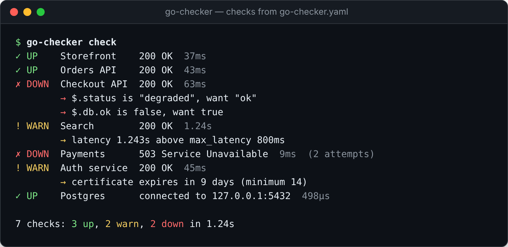

Um único binário, sem dependências, que responde à pergunta que todo time faz várias vezes por dia: **"está tudo funcionando?"**. Mais que "respondeu 200": o go-checker confere se a resposta está **certa** (o JSON, o corpo, os cabeçalhos), se está **rápida**, se o **certificado** não está para vencer, e diz **onde** o tempo foi gasto. Ele usa o código de saída para travar o pipeline e envia alertas para o seu time quando algo cai de verdade.

## Sumário

- [Por que usar](#por-que-usar)
- [Instalação](#instalação)
- [Começo em 1 minuto](#começo-em-1-minuto)
- [Casos de uso](#casos-de-uso)
- [Referência dos comandos](#referência-dos-comandos)
- [Referência da configuração](#referência-da-configuração)
- [Códigos de saída](#códigos-de-saída)
- [Métricas do Prometheus](#métricas-do-prometheus)
- [Dicas](#dicas)
- [Comparação](#comparação)
- [Como funciona](#como-funciona)
- [Desenvolvimento](#desenvolvimento)

## Por que usar

| Sem o go-checker | Com o go-checker |
|---|---|
| O deploy passa no CI e a API sobe com o banco desconectado: o `/health` responde 200 com `"db": false`. | A asserção `json: [{path: $.db.ok, equals: true}]` reprova o deploy em segundos. |
| "O site está lento" e ninguém sabe se é DNS, rede, TLS ou o servidor. | `--trace` separa DNS, conexão, TLS e tempo de resposta do servidor. |
| O certificado vence num domingo e o site cai. | O check vira **WARN** 14 dias antes (configurável) e **DOWN** quando vence. |
| Um pacote perdido acorda o plantão às 3h. | O alerta só sai depois de N rodadas seguidas (`--confirm`). |
| Escrever checks para 40 endpoints. | `go-checker init --from-openapi` gera os checks a partir da spec da API. |
| Ferramentas de monitoramento pesadas, com banco e interface. | Um binário de poucos MB, configuração em YAML versionada junto com o código. |

### Destaques

- 🎯 **Asserções:** status (um ou vários), latência máxima, texto e regex no corpo, valores no JSON (`$.data.items[0].id`) e cabeçalhos.
- 🔬 **Raio-x da requisição:** tempos de DNS, TCP, TLS, primeiro byte (TTFB) e total.
- 🔐 **Certificado TLS:** dias até expirar, com aviso configurável.
- 🔁 **Retentativas inteligentes:** backoff exponencial com jitter, só para erros transitórios (rede e 5xx).
- 🚦 **Códigos de saída para CI:** 0 tudo certo, 1 algo falhou, 2 erro de configuração.
- 📄 **Relatórios:** texto colorido, JSON, JUnit (GitHub, GitLab e Jenkins), Markdown e resumo automático no GitHub Actions.
- 🧩 **GitHub Action pronta**.
- 📈 **Modo monitor:** métricas do Prometheus (p50, p95 e p99) e alertas no Slack, Discord, Teams, Telegram ou num webhook, com proteção contra oscilação.
- 🪄 **Geração a partir de OpenAPI 3**.
- 🔌 **Além de HTTP:** portas TCP (banco, cache, SMTP) e resolução de DNS.
- 🔑 **Segredos fora do arquivo:** `${VAR}` vindo do ambiente, e autenticação basic e bearer.
- 🛡️ **Configuração estrita:** uma chave digitada errada vira erro com a linha e a sugestão certa.
- 📦 **Distribuição:** Linux, macOS e Windows (amd64 e arm64), imagem Docker e `go install`.

## Instalação

**Com Go (1.24 ou mais novo):**

```bash
go install github.com/fabiodrneles/go-checker@latest
```

**Binário pronto:** baixe o arquivo do seu sistema em [Releases](https://github.com/fabiodrneles/go-checker/releases/latest), confira o `checksums.txt` e coloque o `go-checker` no `PATH`. No Linux e no macOS:

```bash
VERSION=$(curl -s https://api.github.com/repos/fabiodrneles/go-checker/releases/latest | grep -o '"tag_name": *"[^"]*"' | cut -d'"' -f4)
OS=$(uname -s); ARCH=$(uname -m); [ "$ARCH" = aarch64 ] && ARCH=arm64
curl -fsSLO "https://github.com/fabiodrneles/go-checker/releases/download/${VERSION}/go-checker_${VERSION#v}_${OS}_${ARCH}.tar.gz"
tar -xzf go-checker_*.tar.gz go-checker && sudo mv go-checker /usr/local/bin/
go-checker version
```

**Docker:**

```bash
docker run --rm ghcr.io/fabiodrneles/go-checker check https://example.com
```

**GitHub Actions:** veja o caso de uso [Travar um deploy quebrado no CI](#1-travar-um-deploy-quebrado-no-ci).

## Começo em 1 minuto

Verifique qualquer URL, sem arquivo nenhum:

```bash
go-checker check https://example.com https://api.github.com
```

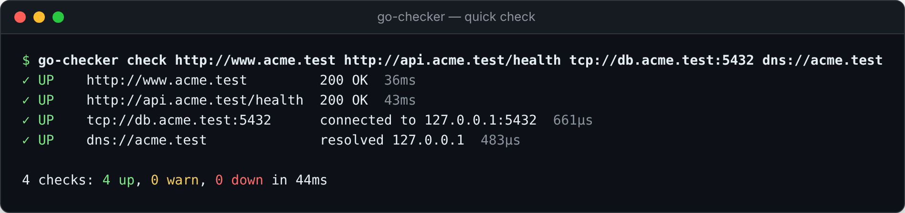

Para um conjunto fixo de checks, crie o arquivo e rode:

```bash
go-checker init          # escreve um go-checker.yaml comentado
go-checker check         # lê go-checker.yaml, checks.yaml ou config.yaml
```

Experimente sem instalar nada, de dentro deste repositório:

<!-- doc-commands -->
```bash
go run . version
go run . init -f - | sed -n 1,12p
go run . init --from-openapi examples/openapi.yaml -f - | grep -c "url:"
```

## Casos de uso

Cada caso traz o problema, o que o go-checker faz, o comando para copiar e colar e um exemplo da saída real.

### 1. Travar um deploy quebrado no CI

**Problema:** o pipeline publica uma versão, os testes passaram, mas em produção a API responde erro ou a dependência está fora.
**Solução:** depois do deploy, o go-checker verifica os endpoints. Qualquer falha encerra com o código 1 e o job fica vermelho. O motivo aparece no log e no resumo do job.

```yaml
# .github/workflows/deploy.yml (depois do passo de deploy)
- name: Smoke test
  uses: fabiodrneles/go-checker@v1.0.0
  with:
    file: go-checker.yaml          # ou urls: https://app.example.com/health
    args: --retries 2              # tolera a API ainda subindo
    junit: reports/smoke.xml       # opcional: resultado como testes
```

O mesmo vale para qualquer CI (GitLab, Jenkins, Azure DevOps ou um script), porque o contrato é o código de saída:

```bash
go-checker check -f go-checker.yaml --retries 2 || exit 1
```

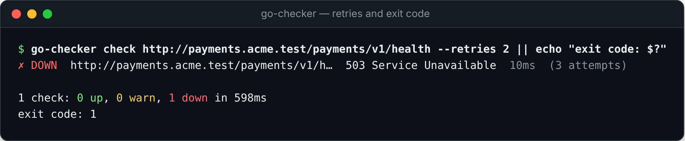

A Action expõe as saídas `up`, `warn`, `down`, `report` (o JSON) e `exit-code`. Com `fail: "false"`, ela só relata e não reprova o job.

### 2. Saber se a API está certa, não só no ar

**Problema:** o `/health` responde 200 mesmo com o banco desconectado, ou o balanceador devolve uma página de erro com status 200.
**Solução:** asserções sobre o conteúdo. Cada falha diz o esperado e o encontrado.

```yaml
checks:
  - name: Checkout API
    url: https://api.example.com/checkout/health
    expect:
      status: 200
      headers: {Content-Type: application/json}
      json:
        - {path: $.status, equals: ok}
        - {path: $.db.ok, equals: true}
        - {path: $.error, exists: false}
```

```bash
go-checker check -f go-checker.yaml
```

Na imagem do topo, o *Checkout API* responde 200, mas fica **DOWN** porque `$.status` é `"degraded"` e `$.db.ok` é `false`.

### 3. Descobrir por que está lento

**Problema:** "o site está lento" não diz onde.
**Solução:** `--trace` mostra cada fase da requisição e os dados do certificado. Um DNS lento, um handshake TLS lento e um servidor lento (TTFB alto) pedem correções diferentes.

```bash
go-checker check https://example.com --trace
```

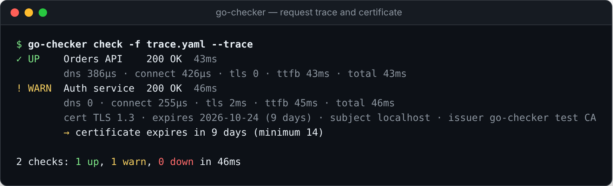

Para tornar lentidão um sinal, use `max_latency`. Estourar o limite deixa o check **WARN**, não DOWN, porque um site lento ainda está no ar:

```yaml
expect:
  max_latency: 800ms
```

### 4. Nunca mais deixar um certificado vencer

**Problema:** o certificado TLS expira e o site some do ar para os navegadores.
**Solução:** todo check HTTPS confere a validade. Abaixo de `tls_min_days` (padrão 14) o check vira **WARN**; vencido, **DOWN**. Rode diariamente no CI ou deixe no `watch`, com a métrica `go_checker_tls_days_left`.

```yaml
defaults:
  tls_min_days: 21
checks:
  - url: https://www.example.com
  - url: https://api.example.com
```

```bash
go-checker check --fail-on-warn   # reprova também quando falta pouco para vencer
```

Serviço interno com certificado próprio? `insecure: true` pula a verificação da cadeia, mas a validade continua sendo avaliada.

### 5. Monitorar 24/7 com Prometheus, Grafana e alertas

**Problema:** você quer saber quando algo cai, sem montar uma plataforma de monitoramento.
**Solução:** `go-checker watch` roda os checks em intervalo, expõe métricas para o Prometheus e avisa o time quando um estado muda de verdade.

```bash
go-checker watch -f go-checker.yaml --interval 30s --confirm 2 \
  --metrics-addr :9090 --slack "$SLACK_WEBHOOK"
```

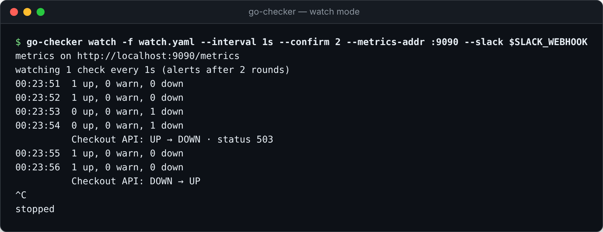

- **Proteção contra oscilação:** com `--confirm 2`, uma rodada ruim não gera alerta; duas seguidas, sim. O mesmo vale para a volta.
- **Canais de alerta**, todos repetíveis:
  - `--slack URL`
  - `--discord URL`
  - `--teams URL`
  - `--telegram BOT_TOKEN:CHAT_ID`
  - `--webhook URL`: um JSON com `name`, `url`, `from`, `to`, `reasons` e `at`, para PagerDuty, Opsgenie ou o seu sistema.
- **Métricas** em `/metrics` e saúde do próprio monitor em `/healthz`:

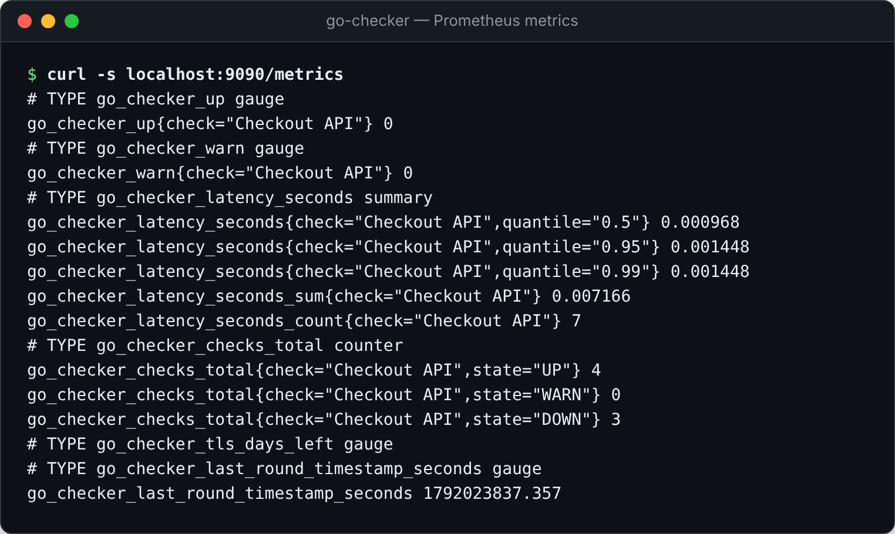

Configuração do Prometheus:

```yaml
scrape_configs:
  - job_name: go-checker
    static_configs:
      - targets: ["go-checker:9090"]
```

Regras de alerta sugeridas:

```yaml
- alert: EndpointDown
  expr: go_checker_up == 0
  for: 2m
- alert: EndpointSlow
  expr: go_checker_latency_seconds{quantile="0.95"} > 1
  for: 10m
- alert: CertificateExpiring
  expr: go_checker_tls_days_left < 14
```

### 6. Rodar como serviço no Docker ou no Kubernetes

**Problema:** o monitor precisa ficar de pé sozinho, perto dos serviços.
**Solução:** a imagem oficial é distroless, roda sem root e serve para amd64 e arm64.

```bash
docker run -d --name go-checker -p 9090:9090 \
  -v "$PWD/go-checker.yaml:/go-checker.yaml:ro" -e SLACK_WEBHOOK \
  ghcr.io/fabiodrneles/go-checker watch -f /go-checker.yaml --metrics-addr :9090 --slack "$SLACK_WEBHOOK"
```

No Kubernetes, use a mesma imagem num `Deployment`, com o arquivo num `ConfigMap`, os segredos em `Secret` (lidos como `${VAR}`) e `/healthz` como `livenessProbe`.

### 7. Começar a partir da especificação OpenAPI

**Problema:** a API tem dezenas de endpoints e ninguém quer escrever um check por um.
**Solução:** `init --from-openapi` lê a spec (YAML ou JSON) e gera um check por GET que pode ser chamado sem inventar valores, com o status esperado documentado. As operações que precisam de parâmetros aparecem no cabeçalho do arquivo, para você completar à mão.

```bash
go-checker init --from-openapi openapi.yaml --base-url https://staging.example.com
go-checker check
```

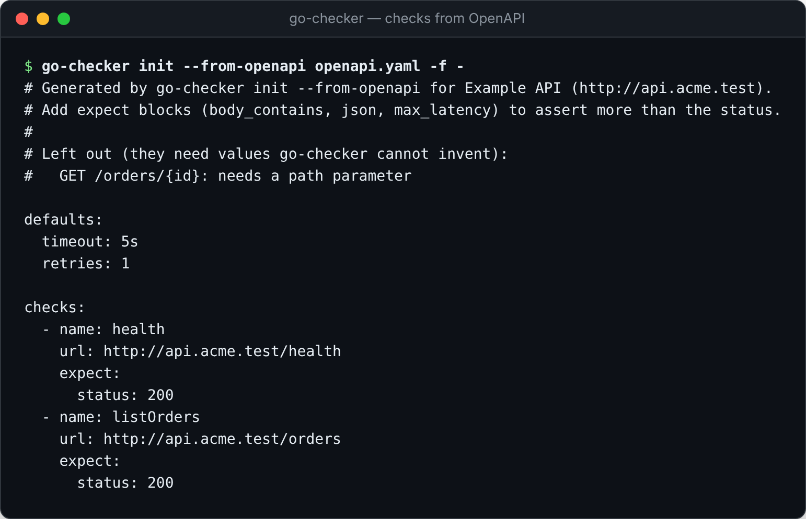

### 8. Verificar banco de dados, cache e DNS

**Problema:** nem tudo é HTTP. O app está no ar, mas o Postgres não aceita conexões, ou o DNS aponta para o lugar errado depois de uma migração.
**Solução:** checks `tcp://` e `dns://` no mesmo arquivo, com o mesmo relatório, retentativas e alertas.

```yaml
checks:
  - name: Postgres
    url: tcp://db.internal:5432
  - name: Redis
    url: tcp://cache.internal:6379
    expect: {max_latency: 50ms}
  - name: DNS do site
    url: dns://www.example.com
    expect:
      body_contains: 93.184.215.14   # o endereço que deveria ser resolvido
```

### 9. Relatórios para pessoas e para máquinas

**Problema:** cada destino quer um formato: o terminal, o painel de testes do CI, um script, um comentário de PR.
**Solução:** `--format` escolhe a saída, e `--output` grava em arquivo sem perder o texto no terminal.

| Formato | Para quê |
|---|---|
| `text` (padrão) | Pessoas. Tem cores só em terminal; `--no-color` ou `NO_COLOR=1` desligam. |
| `json` | Scripts e painéis. Esquema estável: `summary` e `checks[]`, com estado, status, latência, tempos e certificado. |
| `junit` | O painel de testes do GitHub, do GitLab e do Jenkins. Um caso por check. `--junit arquivo` grava junto com outro formato. |
| `markdown` | Comentários de PR, wikis e o resumo do GitHub Actions (automático quando `GITHUB_STEP_SUMMARY` existe). |

```bash
go-checker check --format json --output report.json --junit junit.xml
jq '.checks[] | select(.state != "UP") | {name, reasons}' report.json
```

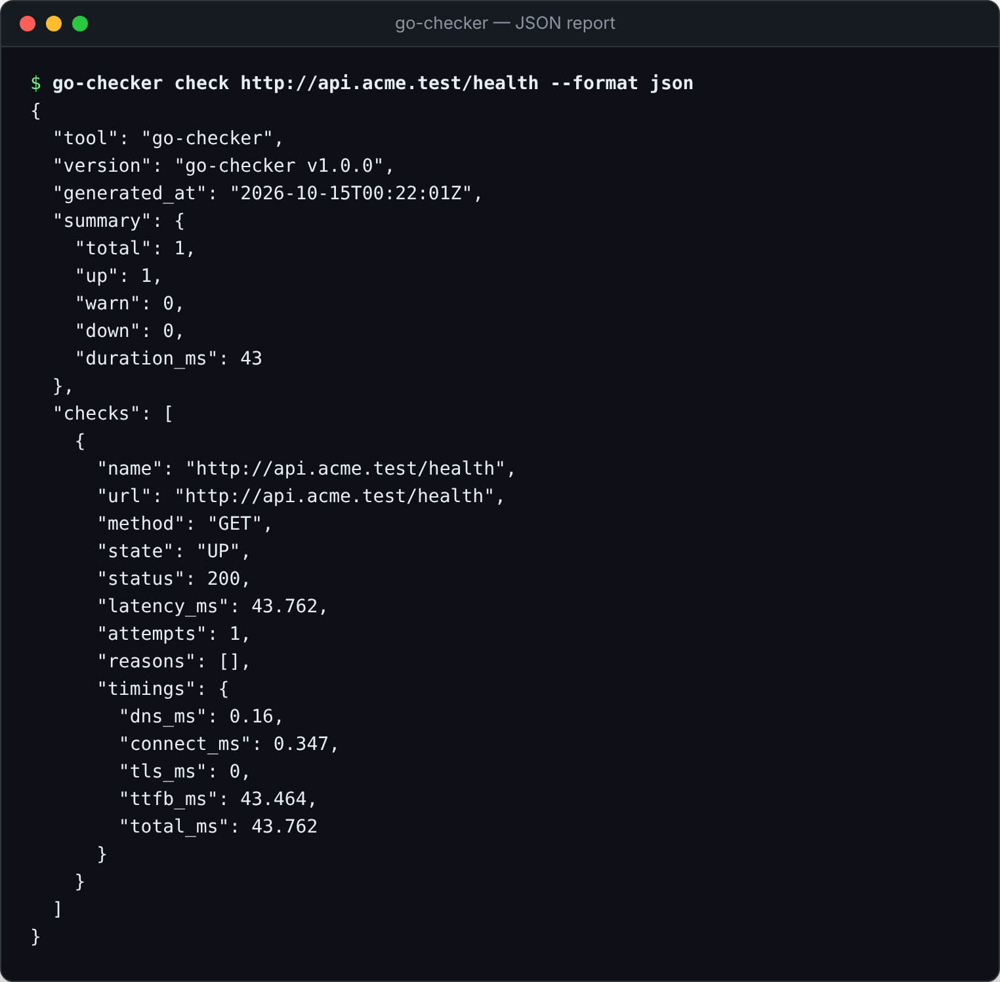

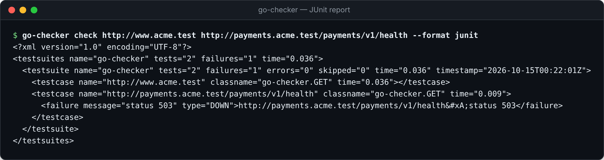

Exemplo do Markdown, como aparece no resumo do job:

> ### go-checker: 3 up, 2 warn, 2 down
>
> | | Check | Status | Latency | Notes |
> |---|---|---|---|---|
> | 🟢 UP | Storefront | 200 | 37ms | |
> | 🔴 DOWN | Checkout API | 200 | 63ms | $.status is "degraded", want "ok" |
> | 🟡 WARN | Search | 200 | 1.24s | latency 1.243s above max_latency 800ms |

### 10. Segredos e autenticação sem expor tokens

**Problema:** o endpoint exige token, e o token não pode ir para o repositório.
**Solução:** `${VAR}` lê do ambiente (no CI, dos *secrets*). `${VAR:-padrão}` define um valor de reserva. Uma variável ausente é erro claro, com a linha, nunca um header vazio enviado em silêncio.

```yaml
checks:
  - name: Admin API
    url: https://${API_HOST:-api.example.com}/admin/health
    auth:
      bearer: ${API_TOKEN}          # ou basic: {username: ..., password: ${PASS}}
```

```bash
API_TOKEN=... go-checker check -f secure.yaml
```

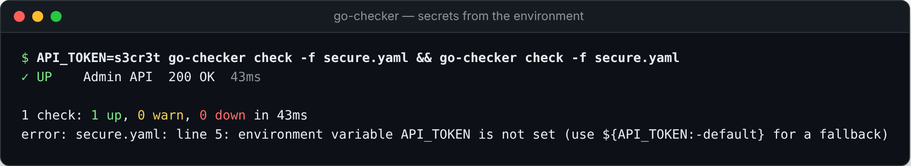

### 11. Configuração que não deixa erro passar

**Problema:** um `timout:` digitado errado e o check roda com o padrão sem ninguém perceber.
**Solução:** toda chave desconhecida é erro (código 2) com a linha e a sugestão mais próxima. O CI pega o erro antes de ele virar um falso "tudo certo".

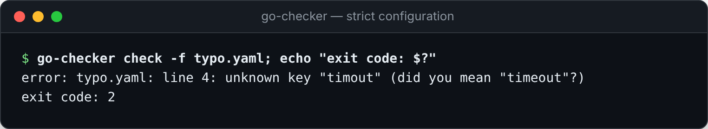

## Referência dos comandos

### `go-checker check [URL...]`

Roda os checks uma vez e encerra com o [código de saída](#códigos-de-saída). Lê as URLs passadas como argumento ou o arquivo de `-f`. Sem nenhum dos dois, procura `go-checker.yaml`, `checks.yaml` e `config.yaml`, nessa ordem.

| Flag | Padrão | O que faz |
|---|---|---|
| `-f, --file` | procura | Arquivo de checks |
| `--timeout` | `10s` | Tempo máximo por tentativa (sobrescreve o arquivo) |
| `--retries` | `0` | Novas tentativas depois de erro de rede ou 5xx (sobrescreve o arquivo) |
| `-c, --concurrency` | `10` | Checks rodando ao mesmo tempo |
| `--trace` | | Mostra DNS, conexão, TLS, TTFB e o certificado |
| `-o, --format` | `text` | `text`, `json`, `junit` ou `markdown` |
| `--output` | | Grava o relatório num arquivo (o terminal continua mostrando o texto) |
| `--junit` | | Grava também um JUnit |
| `--fail-on-warn` | | Sai com 1 também quando há WARN |
| `--no-color` | | Sem cores (também `NO_COLOR=1`) |

### `go-checker watch [URL...]`

Roda os checks a cada `--interval` até receber Ctrl+C ou SIGTERM. Aceita as flags de leitura e de execução do `check` (`-f`, `--timeout`, `--retries`, `--concurrency`), mais:

| Flag | Padrão | O que faz |
|---|---|---|
| `--interval` | `30s` | Tempo entre rodadas (mínimo 1s) |
| `--confirm` | `2` | Rodadas seguidas para uma mudança de estado valer |
| `--metrics-addr` | | Endereço do `/metrics` e do `/healthz` (ex.: `:9090`) |
| `--window` | `100` | Respostas usadas nos quantis de latência |
| `--slack`, `--discord`, `--teams` | | URL do webhook do canal (repetível) |
| `--telegram` | | `BOT_TOKEN:CHAT_ID` (repetível) |
| `--webhook` | | Recebe cada mudança em JSON (repetível) |

### `go-checker init`

| Flag | Padrão | O que faz |
|---|---|---|
| `--from-openapi` | | Spec OpenAPI 3 (YAML ou JSON) para gerar os checks |
| `--base-url` | primeiro `servers[]` | URL base da API |
| `-f, --file` | `go-checker.yaml` | Arquivo a gravar (`-` para a saída padrão) |
| `--force` | | Sobrescreve um arquivo existente |

### `go-checker version`

Mostra a versão e o commit do build (também `--version`).

## Referência da configuração

```yaml
defaults:                    # vale para todos os checks
  timeout: 10s               # por tentativa: 500ms, 5s, 1m
  retries: 0                 # 0 a 10, só depois de erro de rede ou 5xx
  tls_min_days: 14           # WARN quando o certificado vence antes disso
  headers: {X-Team: sre}     # somados aos de cada check

checks:
  - name: Checkout API       # padrão: a URL
    url: https://api.example.com/checkout/health   # http(s)://, tcp://host:porta, dns://nome
    method: GET              # GET, HEAD, POST, PUT, PATCH, DELETE, OPTIONS
    headers: {Accept: application/json}
    body: '{"ping": true}'
    timeout: 5s
    retries: 2
    tls_min_days: 30
    insecure: false          # true: aceita certificado próprio (a validade continua avaliada)
    auth:                    # basic ou bearer
      bearer: ${API_TOKEN}
    expect:
      status: [200, 204]     # sem status: qualquer código abaixo de 400 passa
      max_latency: 800ms     # estourou: WARN
      body_contains: '"ok"'
      body_regex: 'version":"v[0-9]+'
      headers: {Content-Type: json}   # o valor contém o texto
      json:
        - {path: $.status, equals: ok}          # números, textos, booleanos, listas e objetos
        - {path: $.items[0].id, exists: true}
        - {path: $.error, exists: false}
```

- **JSON path:** `$.a.b`, `$.lista[0]`, `$["chave com espaço"]` e combinações.
- **Variáveis:** `${VAR}` e `${VAR:-padrão}` em qualquer valor; `$${` escreve `${`. Linhas de comentário não são expandidas.
- **Formato antigo:** `sites: - url:` continua aceito.
- **Estados:** **UP** (tudo certo), **WARN** (lento ou certificado perto de vencer: passa, mas avisa) e **DOWN** (falhou).

## Códigos de saída

| Código | Significado | Exemplo |
|---|---|---|
| `0` | Todos os checks passaram (WARN também, sem `--fail-on-warn`) | Deploy liberado |
| `1` | Pelo menos um check falhou | API fora, asserção quebrada, certificado vencido |
| `2` | Erro de uso ou de configuração | Arquivo inválido, chave desconhecida, flag errada |

O código 2 separa "o sistema está fora" de "o check está mal escrito". O alerta de uma coisa não se confunde com o da outra.

## Métricas do Prometheus

| Métrica | Tipo | O que mede |
|---|---|---|
| `go_checker_up{check}` | gauge | 1 se passou na última rodada (UP ou WARN), 0 se DOWN |
| `go_checker_warn{check}` | gauge | 1 se passou com aviso |
| `go_checker_latency_seconds{check,quantile}` | summary | p50, p95 e p99 das últimas `--window` respostas, mais `_sum` e `_count` |
| `go_checker_checks_total{check,state}` | counter | Checks por estado |
| `go_checker_tls_days_left{check}` | gauge | Dias até o certificado vencer |
| `go_checker_last_round_timestamp_seconds` | gauge | Hora da última rodada (para alertar se o monitor parar) |

## Dicas

- **Saúde profunda:** aponte para um endpoint que toca as dependências (banco, fila) e afirme sobre o JSON. Um `/ping` que só responde "pong" não prova nada.
- **CI logo depois do deploy:** `--retries 2` e `timeout: 5s` cobrem a janela em que a nova versão ainda está subindo.
- **Monitor sem alarme falso:** `--confirm 2` com `--interval 30s` alerta em cerca de 1 minuto e ignora oscilações isoladas.
- **Um arquivo por ambiente:** `go-checker.staging.yaml` e `go-checker.prod.yaml`, ou um só com `https://${HOST}/...`.
- **Rotina diária de certificados:** um workflow agendado (`schedule:`) com `go-checker check --fail-on-warn` avisa semanas antes.
- **Filtrar o JSON:** `jq '.checks[] | select(.state=="DOWN") | .name' report.json`.
- **Muitos endpoints:** aumente `--concurrency`; os resultados continuam na ordem do arquivo.
- **Sem cores em logs:** a saída já vem sem cores fora de um terminal; `NO_COLOR=1` força.

## Comparação

| | go-checker | Gatus | Uptime Kuma | Blackbox Exporter | Hurl |
|---|---|---|---|---|---|
| Um binário, configuração em YAML | ✅ | ✅ | ❌ (interface e banco) | ✅ | ✅ (formato próprio) |
| Código de saída para CI | ✅ | ❌ | ❌ | ❌ | ✅ |
| JUnit, JSON, Markdown e resumo do job | ✅ | ❌ | ❌ | ❌ | parcial |
| Asserções em JSON | ✅ | ✅ | parcial | ❌ | ✅ |
| Tempos por fase (DNS, TCP, TLS, TTFB) | ✅ | ❌ | ❌ | ✅ | ✅ |
| Validade do certificado | ✅ | ✅ | ✅ | ✅ | ✅ |
| Geração a partir de OpenAPI | ✅ | ❌ | ❌ | ❌ | ❌ |
| Prometheus e alertas com proteção contra oscilação | ✅ | ✅ | ✅ | via Alertmanager | ❌ |
| Página de status | ❌ | ✅ | ✅ | ❌ | ❌ |

O go-checker foi feito para quem quer verificação como código: a mesma configuração serve no terminal, no pipeline e no monitor. Se o que você precisa é uma página de status pública, Gatus e Uptime Kuma atendem melhor.

## Como funciona

```text
go-checker.yaml ──► config (valida, ${VAR}, padrões)
                        │
                        ▼
                 runner (concorrência, retentativas com backoff e jitter)
                        │  para cada check
                        ▼
                 probe (HTTP com httptrace · TCP · DNS) ──► tempos, certificado
                        │
                        ▼
                 assert (status, corpo, JSON, cabeçalhos, latência) ──► UP · WARN · DOWN
                        │
          ┌─────────────┴─────────────┐
          ▼                           ▼
  check: relatórios e           watch: métricas, filtro contra
  código de saída               oscilação e alertas
```

Tudo é escrito com a biblioteca padrão do Go, mais `cobra` (CLI) e `yaml.v3`. O formato do Prometheus e o JSON path são implementados no projeto.

## Desenvolvimento

```text
make ci        # lint, testes com race detector, cobertura ≥ 80% e build
make docs      # markdownlint
```

O projeto segue *Spec Driven Development* com o [sdd-kit](https://github.com/fabiodrneles/sdd-kit). Cada funcionalidade tem uma spec em [`specs/`](specs/README.md) com critérios de aceite, e cada critério é citado por um teste. Os testes só falam com servidores locais (`httptest`) e rodam em Linux, macOS e Windows. As releases saem pelo [go-release-manager](https://github.com/fabiodrneles/go-release-manager), pelos Conventional Commits, e o GoReleaser publica os binários.

Contribuições são bem-vindas: veja [CONTRIBUTING.md](CONTRIBUTING.md).

## Licença

[MIT](LICENSE) © Fabio Dorneles
